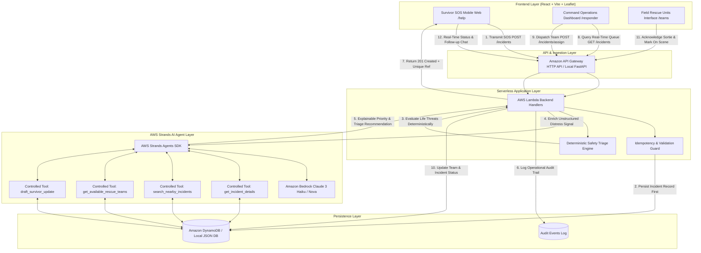

# FloodRescue AI — System Architecture & Technical Design

**WeMakeDevs × AWS Environmental Hackathon 2026**  
*Track: Heat & Water (Flood Disaster Management) | Category: Agents & AI*  
*Tagline: Every Distress Signal Matters. Every Rescue Counts.*

---

## 1. System Overview

FloodRescue AI is an AI-assisted emergency response platform designed to eliminate chaos during severe flood events. When rising floodwaters overwhelm emergency dispatch channels, reports flood in as disjointed phone calls, social media cries, and SMS messages. FloodRescue AI provides:

1. **Frictionless Mobile Reporting (`/help`):** Allows distressed citizens to transmit an SOS in seconds with or without GPS, capturing exact or approximate landmarks, trapped people counts, water depths, and critical medical needs.
2. **Deterministic-First Safety Layer:** Immediately evaluates threat to life using deterministic rules before running AI inference, guaranteeing that no life-threatening report is delayed or dropped.
3. **AWS Strands AI Agent Engine:** Employs the AWS Strands Agents SDK to extract structured intelligence from unstructured natural language messages, check nearby clusters to prevent duplicate sorties, and draft explainable dispatch recommendations for incident commanders.
4. **Operations Command Center (`/responder`):** An interactive geospatial dashboard providing complete situational awareness, distinguishing reported people from incident counts, and facilitating authorized team dispatches.
5. **Field Rescue Fleet Roster (`/teams`):** Tracking status and capabilities of swift-water boat units, paramedics, and high-clearance evacuation trucks.

---

## 2. End-to-End Architectural Flow

---

## 3. Core Component Breakdown

### 3.1. Frontend Web Application (React, Vite, TypeScript, Tailwind CSS, Leaflet)
- **Zero Account Barrier:** Survivors report distress without login or password friction.
- **Dual Location Support:** Browser GPS geolocation with graceful fallback to landmark addresses and interactive map-pin placement.
- **Strict Distinction:** Clear visual separation between exact coordinates (`location_precision: exact`) and coarse approximations (`location_precision: approximate`).
- **Low-Bandwidth Resilient:** Lightweight SVG icons, minimal network overhead, offline-tolerant submission with unique idempotency keys.

### 3.2. Deterministic Safety Triage Engine
Emergency response software must never rely solely on probabilistic model outputs to detect imminent death:
- **Immediate Life Threat Keywords:** Trapped on roof, submerging structure, drowning, cardiac crisis, unconscious, heavy bleeding, dialysis/oxygen cutoff.
- **Environmental Hazard Scaling:** Chest-deep or submerged roof immediately triggers `CRITICAL` priority.
- **Explainability:** Generates a deterministic list of human-readable reasons (e.g. *"Chest-deep rising water with trapped elderly asthma patient"*).

### 3.3. AWS Strands AI Agent Engine (`strands-agents`)
The AI agent operates under strict sandbox principles:
- **Controlled Application Tools:** The agent only accesses predefined, typed tools (`get_incident_details`, `search_nearby_incidents`, `get_available_rescue_teams`, `get_team_details`, `summarize_incident`, `recommend_priority`, `draft_survivor_update`).
- **Zero Hallucination Tolerance:** The agent cannot invent coordinates, fabricate responder availability, or modify database records directly.
- **Graceful Cloud Fallback:** If Amazon Bedrock credentials are not present or encounter rate limits/timeouts, the engine falls back to deterministic safety triage rules without throwing user-facing errors or dropping records.

### 3.4. Persistence Layer (DynamoDB & Local Adapter)
- **AWS Mode (`APP_MODE=aws`):**
  - `FloodRescue-Incidents`: Primary key `incident_id` (String), GSI `IdempotencyIndex` (`idempotency_key`).
  - `FloodRescue-Teams`: Primary key `team_id` (String).
  - `FloodRescue-Messages`: Primary key `message_id` (String), GSI `IncidentIndex` (`incident_id`).
  - `FloodRescue-Audit`: Primary key `event_id` (String).
- **Local Dev Mode (`APP_MODE=local`):**
  - `LocalJsonPersistenceAdapter` storing deterministic state in `data/local_db.json`. Fully thread-safe, supporting filtering, sorting, pagination, and demonstration dataset seeding.

---

## 4. Security & Privacy Architecture

1. **Least Privilege IAM:** Lambda execution role is strictly constrained to DynamoDB CRUD on the application's four tables and `bedrock:InvokeModel` on authorized foundational models.
2. **Public Data Protection:** Survivors cannot browse other survivors' personal distress details. The public endpoint only exposes the single incident tracking reference when the survivor possesses their unique incident ID.
3. **Idempotency Defense:** Repeated clicks on SOS submissions during network stress do not spawn duplicate records in DynamoDB.
4. **No Plaintext Secrets:** Zero AWS access keys or tokens stored in frontend repositories or client bundles.
5. **Comprehensive Audit Log:** Every team assignment, acknowledgment, and resolution records the dispatcher ID, timestamp, and target entity in an immutable audit ledger.

---

## 5. Feasibility Boundaries & Honest Engineering Disclosures

1. **Cellular Network Discovery:** Standard web applications cannot interrogate cellular telecom towers or count unregistered mobile subscribers in a flood polygon. FloodRescue AI counts reported individuals from active reports and calculates `people_reported` separately from `known_reported_incidents`.
2. **Hydrological Routing:** The agent does not calculate swift-water boat navigation routes. Water current velocities, submerged trees, and downed power lines require human incident commander verification.
3. **Human In The Loop:** AI recommendations advise and summarize; human commanders authorize dispatches.
